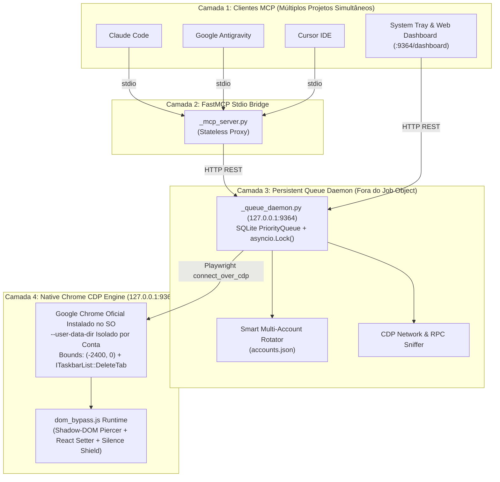
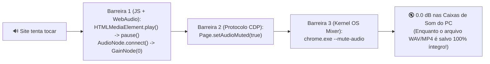

<div align="center">

# ⚡ MCP Creator — Connect Anything

### **Transforme QUALQUER Site, SaaS ou Plataforma Web em um Servidor MCP Inquebrável, Multi-Conta, Invisível e Auto-Curável (Self-Healing)**

[](https://modelcontextprotocol.io)
[](#)
[](#)
[](#)
[](#)

*Construído a partir da engenharia real de produção do **[Flow Studio MCP](https://github.com/NicolasCoder/flow-studio-mcp)** (Google Veo 3.1 & Nano Banana 2.1), **[Adobe Podcast Enhance MCP](https://github.com/NicolasCoder/audio-enhance-mcp)** (SoundLift V2) e **[AI Studio Voice MCP](https://github.com/NicolasCoder/aistudio-voice-mcp)** (Gemini 3.8 TTS).*

---

[**🚀 Começar Agora**](#-como-usar-em-1-minuto) •
[**🧭 As 8 Perguntas do Wizard**](#-a-entrevista-personalizada-as-8-perguntas-de-ouro) •
[**🛠️ Os 7 Pilares**](#️-os-7-pilares-da-arquitetura-blindada) •
[**🤓 Área para Nerds (Deep-Dive)**](#-área-para-nerds-engenharia-profunda-por-trás-dos-panos)

</div>

---

## 💡 Por que criamos o `MCP Creator — Connect Anything`?

A maioria das plataformas mais incríveis da internet (**Google Flow / Veo 3.1, Adobe Podcast Enhance, Google AI Studio Speech, Suno, Udio, Midjourney Web, CapCut Web, ElevenLabs Web, HeyGen, dashboards internos**) **não possui API pública**, ou cobra caro por uma API limitada enquanto oferece **planos gratuitos/ilimitados na interface Web**.

Porém, quando alguém tenta pedir para uma IA criar um MCP comum com Playwright ou Puppeteer para controlar um site, **tudo dá errado**:
- ❌ **Bloqueio de Login (Google / Adobe / Cloudflare Turnstile)**: O navegador de automação exibe *"Este navegador ou app pode não ser seguro"* e nunca deixa você logar;
- ❌ **Janela Pulando na Cara & Áudio Vazando**: O navegador abre roubando o foco do seu teclado e começa a tocar prévias de áudio/vídeo no meio do seu trabalho;
- ❌ **React / Shadow-DOM Ignora os Cliques**: O script digita no campo (`input.value = "..."`), mas o botão *"Generate"* continua cinza/desabilitado porque o React Fiber não reconheceu o evento, ou porque o botão está escondido dentro de 4 camadas de `#shadow-root`;
- ❌ **Acabou os Créditos da Conta = Travou Tudo**: O site atinge o limite diário da conta gratuita e o agente para no meio da madrugada em vez de trocar sozinho para a `conta_2`;
- ❌ **O Site Mudou um Botão = O MCP Morreu**: A plataforma renomeia uma classe CSS e você perde horas reescrevendo código.

O **`MCP Creator — Connect Anything`** empacota **tudo o que aprendemos e validamos em milhares de execuções reais** em uma **Skill Universal de IA + Gerador Interativo (`create_mcp.py`)**. Agora, **qualquer pessoa** pode apontar seu Agente de IA (Claude Code, Google Antigravity, Cursor, Windsurf, Codex) para **qualquer site do mundo** e gerar um MCP com padrão de engenharia industrial em minutos!

---

## 🏆 Nossos Cases Reais que Deram Origem a Este Framework

| MCP de Produção | Plataforma Web Conectada | Engenharia Destilada para o `MCP Creator` |
| :--- | :--- | :--- |
| 🎬 **[Flow Studio MCP](https://github.com/NicolasCoder/flow-studio-mcp)** | Google Flow (`Veo 3.1` & `Nano Banana 2.1`) | Fila Central SQLite (`9334`) + Chrome Isolado (`9333`) + Editor ProseMirror + Upload de Ingredientes/Frames + Modo Fantasma Off-Screen + Auto-Healing |
| 🎙️ **[Adobe Podcast MCP](https://github.com/NicolasCoder/audio-enhance-mcp)** | Adobe Podcast (`Enhance Speech V2 SoundLift`) | **Pool Multi-Login** (`conta_1`, `conta_2`...) com **Rotação Automática de Quota Diária (1h Free / 4h Pro)** + Piercing Recursivo de **Shadow DOM (`<sp-*>`)** + System Tray Flyout |
| 🗣️ **[AI Studio Voice MCP](https://github.com/NicolasCoder/aistudio-voice-mcp)** | Google AI Studio (`Gemini 3.8 Flash TTS`) | **Escudo Triplo de Silêncio Absoluto (0% de áudio nas caixas de som)** + **Captura Tripla Redundante** (Rede RPC MakerSuite + DOM `data:/blob:` + Download UI) |

---

## 🚀 Como Usar em 1 Minuto

Você pode usar o **MCP Creator — Connect Anything** de **duas formas**:

### Opção A: Como uma **Skill de IA** (Claude Code, Antigravity, Cursor, Codex) — *Recomendado!*
Instale a Skill globalmente no seu computador com 1 comando:

```bash
git clone https://github.com/NicolasCoder/mcp-creator-connect-anything.git
cd mcp-creator-connect-anything
python install_skill.py
```

Depois, basta abrir o seu Agente de IA favorito e dizer:
> *"Quero criar um MCP para o site **[Nome do Site / URL]** usando a skill `mcp-creator-connect-anything`!"*

A sua IA vai assumir o papel de **Arquiteto Sênior Web-to-MCP**, fazer as **8 Perguntas de Personalização**, gerar a estrutura blindada, abrir o Chrome para você fazer 1 único login humano, inspecionar os seletores/APIs ao vivo com o Raio-X de Auto-Healing e entregar o MCP instalado e funcionando!

---

### Opção B: Rodando o **Wizard Interativo no Terminal (`create_mcp.py`)**
Se preferir criar a base completa direto pelo terminal respondendo às perguntas passo a passo:

```bash
python create_mcp.py
```

Ou via linha de comando direta (ideal para automações e agentes):

```bash
python create_mcp.py \
  --name "Suno Music Studio" \
  --prefix "suno" \
  --url "https://suno.com/create" \
  --chrome-port 9363 \
  --daemon-port 9364 \
  --visibility offscreen \
  --tray \
  --dashboard \
  --multi-login \
  --quota-reader \
  --quota-unit "credits" \
  --mute-audio \
  --auto-healing \
  --non-interactive
```

---

## 🧭 A Entrevista Personalizada (As 8 Perguntas de Ouro)

Nenhum serviço web é igual ao outro. Por isso, antes de gerar o seu MCP, o **MCP Creator** (via Skill de IA ou Wizard CLI) personaliza o projeto com **8 decisões sob medida**:

1. 🌐 **Qual o Site / Serviço Web Alvo?**
   Define o nome, o prefixo das tools (ex: `suno_execute`, `eleven_execute`) e a URL principal.
2. 👻 **Chrome Escondido (Modo Fantasma Off-Screen) ou Visível?**
   - **Modo Fantasma Off-Screen *(Padrão)***: O navegador roda 100% invisível fora da tela (`X=-2400, Y=0`) e sem ícone na barra de tarefas, sem nunca interromper seu mouse/teclado. Inclui comandos instantâneos `*_show_browser`, `*_hide_browser` e `*_login_browser`.
   - **Modo Sempre Visível** ou **Modo Híbrido**.
3. 🖥️ **Quer Ícone na Bandeja do Sistema (System Tray) & Mini-Dashboard Web?**
   Gera o `<prefix>_tray.py` (ícone no System Tray ao lado do relógio com botões rápidos de *Mostrar/Esconder Chrome, Login, Recarregar Seletores*) e o **Dashboard Web Dark Mode** em `http://127.0.0.1:<porta>/dashboard`!
4. 👥 **Quer Sistema de Multi-Login com Rotação Automática de Contas?**
   Permite conectar `conta_1`, `conta_2`, `conta_3`... em perfis isolados. Quando os créditos ou o limite diário da `conta_1` acabam, o MCP troca sozinho para a `conta_2` em 2 segundos e continua trabalhando!
5. 🪙 **Quer Leitor de Créditos, Limites e Cotas em Tempo Real (`*_quota_status`)?**
   Cria uma tool dedicada para o agente consultar na página (via DOM + API interna) quantos créditos/minutos/tokens restam na conta ativa e no pool total antes de rodar lotes grandes.
6. 🔇 **Quer o Escudo Triplo de Silêncio Absoluto (`Zero-Audio Leak`)?**
   Garante **0% de som saindo nas caixas de som do seu PC**, mesmo em sites que dão auto-play obrigatório em músicas, vozes ou vídeos gerados.
7. ⚡ **Fila Central Única (`SQLite PriorityQueue`) & Portas Isoladas**:
   Define portas exclusivas (`CHROME_PORT` e `DAEMON_PORT`) para que múltiplos projetos e agentes mandem tarefas ao mesmo tempo sem conflito.
8. 🩺 **Kit Completo de Auto-Healing (`Self-Healing MCP`)**:
   Ativa `selectors.json` dinâmico + as 3 tools de autocura (`*_diagnose`, `*_update_selectors`, `*_reload_daemon`).

---

## 🧰 O Que Todo MCP Gerado Já Traz Pronto (11 Tools Nativas)

Ao rodar o gerador para um serviço (ex: prefixo `suno`), seu servidor MCP já nasce com **11 ferramentas completas**:

| Tool MCP Gerada | O que ela faz |
| :--- | :--- |
| `suno_execute` | Envia um job (prompt, arquivo de entrada, parâmetros, prioridade) para a Fila Central e retorna o arquivo final + saldo de créditos. |
| `suno_execute_batch` | Enfileira dezenas de jobs de uma só vez na Fila Central SQLite sem encavalar a aba do navegador. |
| `suno_queue_status` | Consulta o estado da fila em tempo real (jobs rodando, na fila, concluídos) ou aguarda um `job_id`. |
| `suno_quota_status` | Lê na plataforma quantos créditos/minutos restam na conta ativa e a soma consolidada de todas as contas do Pool. |
| `suno_accounts` | Gerencia o Pool Multi-Login (`action="list"`, `"add"`, `"switch"`, `"login"`, `"remove"`, `"set_auto_rotate"`). |
| `suno_login_browser` | Abre o Chrome isolado visível na tela para você fazer o 1º login humano (salva a sessão por meses). |
| `suno_show_browser` | Traz o navegador escondido instantaneamente para a tela (`X=120, Y=90`) para você assistir ao vivo. |
| `suno_hide_browser` | Move o navegador de volta para fora da tela (`X=-2400, Y=0`) e oculta seu ícone da barra de tarefas. |
| `suno_diagnose` | **[Auto-Healing]** Faz um Raio-X completo da página (atravessando Shadow DOMs + rede + screenshot) quando o site muda de layout. |
| `suno_update_selectors` | **[Auto-Healing]** Permite que a própria IA atualize o `selectors.json` em tempo real sem tocar no código Python. |
| `suno_reload_daemon` | **[Auto-Healing]** Recarrega o motor e os seletores em memória a quente, sem fechar o Chrome e sem perder a fila! |

---

# 🤓 Área para Nerds (Engenharia Profunda por Trás dos Panos)

> *Se você gosta de saber **exatamente** como cada engrenagem funciona no nível do Sistema Operacional, do protocolo Chrome DevTools (CDP), da árvore interna do React Fiber e das tabelas virtuais COM do Windows, esta seção foi escrita para você.*

---

### 1. Arquitetura Desacoplada em 4 Camadas (Por que o Navegador Nunca Morre)

Nos servidores MCP comuns, o cliente (Claude Desktop, Cursor, Antigravity) inicia o MCP via `stdio` e cria um **Job Object** do Windows atrelado ao processo. Se o servidor MCP abrir o navegador diretamente como processo filho, qualquer timeout ou reload do cliente mata o navegador instantaneamente.

O **MCP Creator** separa o ecossistema em **4 camadas independentes**:



#### Como escapamos do Windows Job Object (`Win32_Process.Create`)
Quando `<prefix>_mcp_server.py` detecta que o Daemon não está rodando na porta configurada, ele **não** usa `subprocess.Popen` direto. No Windows, ele invoca o provedor WMI do sistema (`Win32_Process.Create`):

```python
ps_cmd = (
    f"Invoke-CimMethod -ClassName Win32_Process -MethodName Create "
    f"-Arguments @{{CommandLine='{cmd_str}'; CurrentDirectory='{BASE_DIR}'}} | Out-Null"
)
```
Isso faz com que tanto o Daemon quanto o `chrome.exe` nasçam como filhos de `WmiPrvSE.exe` (serviço de sistema do Windows), permanecendo vivos 24/7 mesmo que você feche o terminal ou reinicie o cliente de IA!

---

### 2. Zero Bloqueio OAuth & Anti-Bot (Por que Não Usamos Chromium Headless)

Plataformas como **Google (Flow / AI Studio)**, **Adobe (Podcast / Firefly)** e sites protegidos por **Cloudflare Turnstile / Datadome** analisam:
1. `navigator.webdriver` e variáveis injetadas pelo driver de automação;
2. O fingerprint JA3/JA4 da pilha TLS do binário Chromium de teste;
3. O estado da janela (`document.visibilityState === "hidden"` ou janela minimizada) e métricas de renderização da GPU.

**Como o `MCP Creator` passa 100% limpo como um usuário humano real:**
- Usamos o **executável original do Google Chrome** já instalado na máquina (`C:\Program Files\Google\Chrome\Application\chrome.exe`), sem nenhuma flag `--enable-automation` e sem `--headless`.
- A janela roda em `windowState: "normal"` com tamanho real (`1360x860`) e aceleração de hardware ativa, mas posicionada fora da área visível do monitor (`left: -2400, top: 0`) via comando CDP `Browser.setWindowBounds`.
- Para impedir que o motor Blink/V8 reduza a velocidade dos timers quando a janela está fora da tela, injetamos:
  ```text
  --disable-background-timer-throttling
  --disable-backgrounding-occluded-windows
  --disable-renderer-backgrounding
  ```
- **Stealth na Barra de Tarefas via COM VTable (`ITaskbarList`)**:
  No Windows, uma janela em `windowState: "normal"` na posição `X=-2400` ainda mostraria um ícone na barra de tarefas. Para deixá-la 100% invisível sem minimizá-la, acessamos diretamente a tabela virtual de ponteiros de função (VTable) da interface COM nativa do Explorer (`CLSID_TaskbarList = {56FDF344-FD6D-11D0-958A-006097C9A090}`) via `ctypes`:
  - `vtable[5]` (`DeleteTab(hwnd)`): Oculta o botão da barra de tarefas mantendo a janela ativa para o Chrome;
  - `vtable[4]` (`AddTab(hwnd)`): Devolve o botão para a barra de tarefas no exato milissegundo em que você chama `*_show_browser`!

---

### 3. Piercing Recursivo de Shadow DOM & Bypass do React Fiber (`dom_bypass.js`)

Sites modernos são verdadeiras fortalezas de encapsulamento:
- O **Adobe Podcast** constrói toda a interface com **Adobe Spectrum Web Components** (`<sp-theme>`, `<sp-button>`, `<sp-slider>`, `<sp-picker>`), onde cada componente tem seu próprio `#shadow-root` aninhado.
- O **Google Flow** e **AI Studio** usam **Angular Material + Lit + ProseMirror** (`<ms-speech-block>`, `<flow-video-tile>`).
- Aplicações em **React 18/19** interceptam o setter `.value` de todo `<input>` e `<textarea>` com um rastreador interno (`el._valueTracker`).

#### A) Atravessando N Camadas de Shadow DOM (`querySelectorAllDeep`)
Nosso runtime [`templates/dom_bypass.js`](templates/dom_bypass.js) injeta `window.__MCP_CREATOR_BYPASS__.querySelectorDeep(selector)`, que percorre recursivamente toda a árvore DOM e entra em cada `el.shadowRoot` aberto até 8 níveis de profundidade.

#### B) Forçando o Commit de Estado no React Fiber (`setReactInputValue`)
Quando um script comum faz `input.value = "meu texto"`, o `_valueTracker` do React não detecta mudança de estado na fibra e mantém o botão de envio travado. Nossa função extrai o **descritor nativo de propriedade do protótipo C++ do DOM**, atualiza o `_valueTracker` e dispara um `InputEvent` com `composed: true` (que atravessa a barreira do Shadow DOM):

```javascript
const proto = el.tagName.toLowerCase() === "textarea"
  ? window.HTMLTextAreaElement.prototype
  : window.HTMLInputElement.prototype;

const nativeSetter = Object.getOwnPropertyDescriptor(proto, "value")?.set;
if (el._valueTracker) {
  el._valueTracker.setValue(el.value);
}
nativeSetter.call(el, String(newValue));

el.dispatchEvent(new InputEvent("input", {
  bubbles: true,
  composed: true,
  data: String(newValue),
  inputType: "insertText",
}));
```

---

### 4. O Escudo Triplo de Silêncio Absoluto (`0% Audio Leak`)

Quando um MCP gera áudio ou vídeo em segundo plano, a página web quase sempre tenta tocar o resultado automaticamente. Nosso **Escudo Triplo** bloqueia o som em 3 níveis independentes:



O destaque para nerds aqui é o interceptador da **WebAudio API** em `dom_bypass.js`: mesmo que o site sintetize áudio via `AudioContext` sem usar tags `<audio>`, nós fazemos monkey-patch em `AudioNode.prototype.connect`. Sempre que qualquer nó de áudio tenta se conectar ao `context.destination`, nós inserimos silenciosamente um `GainNode` com ganho travado em `0` (`Object.defineProperty(g.gain, 'value', { get: () => 0, set: () => {} })`) no meio do caminho!

---

### 5. Motor de Captura Tripla Redundante (`Triple-Capture Engine`)

Como capturar o arquivo gerado pela plataforma com 100% de confiabilidade e na máxima qualidade original?

1. **Camada 1 — Interceptação Direta de Rede / RPC (`Network Sniffer`)**:
   O Daemon escuta todas as respostas HTTP/RPC da aba. Se a API retornar uma URL assinada do S3/GCS (`presigned_url`) ou pacotes Base64 de streaming (como o `audio/l16; rate=24000` do Google AI Studio), o Python monta o arquivo diretamente dos pacotes de rede.
2. **Camada 2 — Extração Autenticada de `blob:` / `data:` no Contexto da Página (`extractBlobAsBase64`)**:
   Se o site criar um objeto em memória (`blob:https://site.com/uuid-1234`), o Python chama `extractBlobAsBase64(src)` dentro da página, que lê o `Blob` via `fetch()` + `FileReader` usando os cookies da própria aba e devolve os bytes exatos em Base64.
3. **Camada 3 — Captura de Download Nativo (`page.expect_download`)**:
   Se nenhuma das camadas anteriores estiver disponível, o motor aciona o botão de download da UI interceptando o evento nativo de download do Chromium.

---

### 6. Anatomia do Loop Fechado de Auto-Healing (`Self-Healing MCP`)

O que acontece quando o site sofre uma atualização visual de madrugada?

1. O job falha ou não encontra um seletor.
2. Automaticamente, `coletar_diagnostico_pagina()` entra em ação e anexa o objeto `diagnostics` na resposta JSON devolvida ao Agente de IA:
   - **`selector_health`**: Mostra exatamente qual seletor de `selectors.json` retornou `matched_count: 0`;
   - **`dom_snapshot`**: Contém todos os elementos interativos visíveis na tela (mesmo dentro de Shadow DOM), seus `data-testid`, `aria-label`, textos e coordenadas;
   - **`recent_network_calls`**: As últimas 60 requisições de API feitas pela página;
   - **`screenshot_path`**: Foto em alta resolução do estado exato da tela (`diagnostics/last_diagnostic_screenshot.png`).
3. O Agente de IA lê o diagnóstico, descobre o novo seletor em segundos, chama `<prefix>_update_selectors` + `<prefix>_reload_daemon` e **reexecuta a tarefa sem que você precise escrever uma linha de código**!

---

## 📚 Documentação Avançada (`docs/`)

Para se aprofundar ainda mais em cada subsistema, consulte os guias dedicados na pasta [`docs/`](docs/):
- 📐 [**Arquitetura para Nerds: Job Objects, CDP Off-Screen & COM `ITaskbarList`**](docs/AREA_PARA_NERDS_ARQUITETURA.md)
- 🛡️ [**DOM Bypass: Shadow-DOM Piercing, React Fiber Setter & Triple-Capture**](docs/DOM_BYPASS_E_ANTI_BLOQUEIO.md)
- 🩺 [**Protocolo de Auto-Healing & Seletores em Cascata (`selectors.json`)**](docs/AUTO_HEALING_E_SELECTORS.md)
- 👥 [**Sistema Multi-Login, Perfis Isolados & Failover de Créditos/Cotas**](docs/MULTI_LOGIN_E_CREDITOS.md)

---

## 🤝 Contribuindo & Compartilhando seus MCPs

Criou um MCP incrível para uma plataforma nova usando o **MCP Creator — Connect Anything**?
Abra um Pull Request adicionando seu preset de `selectors.json` na pasta `examples/` para ajudar toda a comunidade!

<div align="center">
  <sub>Feito com ⚡ por <b>Nicolas (@NicolasCoder)</b> — Transformando qualquer aplicação Web em superpoderes para Agentes de IA.</sub>
</div>
