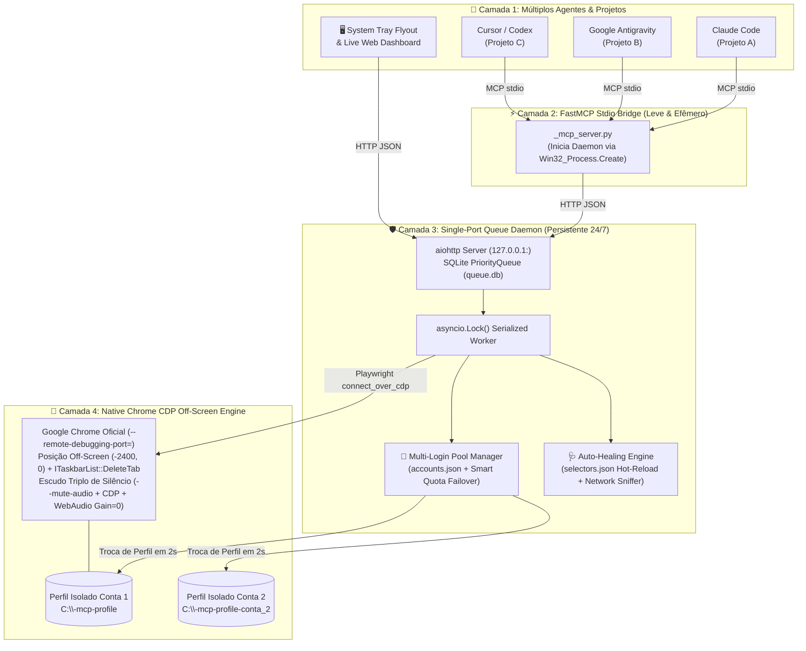

# 🤓 Área para Nerds — Arquitetura Profunda do `MCP Creator: Connect Anything`

Este documento detalha as decisões de engenharia de sistemas operacionais, protocolo CDP (Chrome DevTools Protocol), concorrência assíncrona e isolamento de processos que tornam os MCPs gerados pelo **MCP Creator — Connect Anything** inquebráveis em produção.

---

## 1. O Problema Fundamental: Por que 95% das Automações Web de IA Quebram?

Quando desenvolvedores tentam conectar um Agente de IA (Claude Code, Cursor, Antigravity) a um serviço Web usando Playwright/Puppeteer convencional dentro de um servidor MCP `stdio`, quatro falhas catastróficas acontecem:

1. **Morte Súbita por Windows Job Object / SIGHUP**:
   O protocolo MCP roda via `stdio` como subprocesso do cliente de IA. Se o servidor MCP abrir o navegador diretamente (`subprocess.Popen` comum ou `playwright.chromium.launch()`), o Windows associa o Chrome ao mesmo **Job Object** do comando. Quando o agente reinicia ou dá timeout numa tool call, o navegador morre no meio da geração!
2. **Bloqueio de Login OAuth (Google / Adobe / Cloudflare Turnstile)**:
   O binário Chromium baixado pelo Playwright injeta `navigator.webdriver = true`, altera assinaturas TLS/JA3 e não possui os codecs proprietários nem o cofre de identidade do Google Chrome oficial. Resultado: *"Este navegador ou app pode não ser seguro"* ao tentar logar com Google ou Adobe.
3. **Colisão de Abas em Execução Multi-Agente**:
   Quando você tem 3 agentes ou projetos rodando ao mesmo tempo e todos chamam a tool do MCP simultaneamente, 3 cliques concorrentes acontecem na mesma aba do navegador, corrompendo o prompt e misturando os arquivos baixados.
4. **Roubo de Foco e Vazamento de Áudio (`Focus Stealing & Audio Leak`)**:
   Janelas de automação comuns pulam na frente do editor de código enquanto você digita e disparam prévias de áudio/vídeo a todo volume nas caixas de som do PC.

---

## 2. A Nossa Arquitetura em 3 Camadas Desacopladas



---

## 3. Desacoplamento Total de Processo via WMI `Win32_Process.Create`

Para impedir que o encerramento de uma sessão MCP mate o Daemon da Fila ou o Google Chrome, usamos a chamada WMI nativa do Windows (`Win32_Process.Create`), que cria o processo como filho direto de `WmiPrvSE.exe` (fora da árvore de processos e fora do Job Object do terminal pai):

```python
cmd_str = f'"{pythonw_exe}" "{DAEMON_SCRIPT}"'
ps_cmd = (
    f"Invoke-CimMethod -ClassName Win32_Process -MethodName Create "
    f"-Arguments @{{CommandLine='{cmd_str}'; CurrentDirectory='{BASE_DIR}'}} | Out-Null"
)
subprocess.run(["powershell", "-NoProfile", "-WindowStyle", "Hidden", "-Command", ps_cmd])
```

No macOS e Linux, o mesmo efeito é garantido via `start_new_session=True` (`setsid()`).

---

## 4. Isolamento Cirúrgico por Par de Portas (`Zero Cross-Process Kill`)

No ecossistema do **MCP Creator**, você pode rodar 5 ou 10 MCPs simultaneamente (Flow Studio, Adobe Podcast, AI Studio Voice, Suno, ElevenLabs, etc.) sem que um interfira no outro e sem jamais fechar o seu navegador Chrome pessoal:

| Serviço MCP | Porta CDP do Chrome | Porta HTTP do Daemon | Diretório de Perfil Isolado |
| :--- | :---: | :---: | :--- |
| **Flow Studio MCP** | `9333` | `9334` | `C:\flow-mcp-profile` |
| **Adobe Podcast MCP** | `9343` | `9344` | `C:\adobe-podcast-mcp-profile` |
| **AI Studio Voice MCP** | `9353` | `9354` | `C:\aistudio-mcp-profile` |
| **Novo MCP #1 (Gerado)** | `9363` | `9364` | `C:\<prefix>-mcp-profile` |
| **Novo MCP #2 (Gerado)** | `9373` | `9374` | `C:\<prefix2>-mcp-profile` |

Quando o Daemon precisa reiniciar o Chrome (por exemplo, para alternar da `conta_1` para a `conta_2`), a função `fechar_chrome_porta(porta)` inspeciona a linha de comando (`cmdline`) via `psutil` e **encerra exclusivamente a árvore de PIDs que contém `--remote-debugging-port=<PORTA_DO_MCP>`**.

---

## 5. O Segredo do Modo Fantasma (`Off-Screen` + `ITaskbarList` COM VTable)

Por que não usar `--headless=new`?
1. Sites protegidos por reCAPTCHA v3 Enterprise e Cloudflare medem se a janela está em estado `minimized` ou `headless` e derrubam o score de confiança para `0.1`.
2. Navegadores minimizados sofrem **Timer Throttling** no Blink/V8 (`requestAnimationFrame` para de rodar e `setTimeout` é limitado a 1 minuto), travando SPAs como Google Flow e Adobe Podcast.

**Como o `MCP Creator` resolve isso:**
1. O Chrome é iniciado com janela real (`windowState: "normal"`), resolução completa (`1360x860`) e as 3 flags anti-throttling:
   - `--disable-background-timer-throttling`
   - `--disable-backgrounding-occluded-windows`
   - `--disable-renderer-backgrounding`
2. Via CDP (`Browser.setWindowBounds`), movemos a janela para a coordenada `left: -2400, top: 0` (fora do monitor visível, mas 100% renderizada pela GPU!).
3. Para não poluir a barra de tarefas do Windows com um ícone fantasma do Chrome, acessamos diretamente a VTable da interface COM `ITaskbarList` (`CLSID {56FDF344-FD6D-11D0-958A-006097C9A090}`) via `ctypes`:
   - `vtable[5]` (`ITaskbarList::DeleteTab(hwnd)`): Remove o ícone da Taskbar quando em modo invisível.
   - `vtable[4]` (`ITaskbarList::AddTab(hwnd)`): Restaura o ícone na Taskbar instantaneamente quando o usuário chama `<prefix>_show_browser`!
