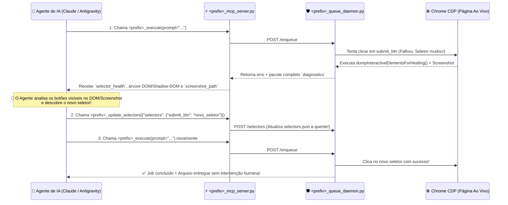

# 🩺 Protocolo de Auto-Healing (`Self-Healing MCP`) & `selectors.json`

Todo site web muda de layout, renomeia classes CSS ou altera rotas de API com o tempo. Nos scrapers tradicionais, quando um botão muda de `aria-label="Generate"` para `data-testid="create-btn"`, a automação quebra e o usuário precisa chamar um programador.

Nos MCPs gerados pelo **MCP Creator — Connect Anything**, **o próprio Agente de IA conserta o MCP sozinho em menos de 10 segundos** usando o **Loop Fechado de Auto-Healing**.

---

## 1. Regra de Ouro: Zero Seletores Hardcoded no Python

Nenhum seletor CSS, XPath ou rota de API fica escondido dentro do código Python (`<prefix>api.py`). Tudo reside em **`selectors.json`**, que é lido dinamicamente a cada operação:

```json
{
  "selectors": {
    "prompt_input": "[data-testid=\"prompt-input\"], textarea[placeholder*=\"Describe\"], .ProseMirror",
    "submit_btn": "[data-testid=\"generate-button\"], button:has-text(\"Generate\"), button:has-text(\"Gerar\")",
    "download_btn": "[data-testid=\"download-button\"], button[aria-label*=\"Download\"]"
  }
}
```

---

## 2. Como Funciona o Loop Fechado de Auto-Healing



---

## 3. As 3 Ferramentas Nativas de Auto-Healing

Todo MCP gerado pelo `create_mcp.py` já expõe nativamente:

### 1. `<prefix>_diagnose(take_screenshot=True)`
Executa um raio-X completo da aba ativa do Chrome:
- **`selector_health`**: Testa cada chave do `selectors.json` atual contra a página ao vivo e informa quantos elementos deram match (`matched_count: 0` mostra exatamente qual seletor quebrou!).
- **`dom_snapshot`**: Varre recursivamente o DOM e todos os **Shadow DOMs** até 8 níveis de profundidade, retornando:
  - `interactive`: Lista de todos os botões, links, inputs, textareas e sliders visíveis com `tag`, `id`, `testid`, `aria`, `placeholder`, `text`, `inShadowDom` e coordenadas `(x, y, w, h)`.
  - `testids`: Lista ordenada de todos os atributos `data-testid` existentes na página.
  - `customWebComponents`: Lista de todas as custom tags (`<sp-*>`, `<ms-*>`, `<flow-*>`, etc.).
  - `alertsOrModals`: Qualquer modal de upsell, aviso ou erro visível que esteja bloqueando o clique.
- **`recent_network_calls`**: As últimas 60 chamadas HTTP/RPC interceptadas pelo sniffer do daemon (método, status, URL e preview do JSON).
- **`screenshot_path`**: Caminho absoluto do print da tela atual salvo em `diagnostics/last_diagnostic_screenshot.png`.

### 2. `<prefix>_update_selectors(updates)`
Permite que o Agente de IA atualize qualquer seletor ou endpoint em `selectors.json` instantaneamente via JSON merge, sem precisar editar arquivos na mão nem reiniciar o navegador.

### 3. `<prefix>_reload_daemon()`
Executa `importlib.reload(core_api)` dentro do Daemon persistente, recarregando qualquer alteração feita em `<prefix>api.py` ou `selectors.json` **sem fechar o Chrome e sem perder os jobs que estão na fila SQLite**!
