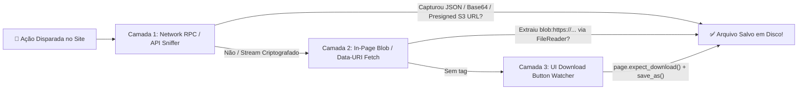

# 🛡️ DOM Bypass, Shadow-DOM Piercing & Escudo Anti-Bloqueio

Este guia técnico explica como o motor `dom_bypass.js` do **MCP Creator — Connect Anything** supera as barreiras das aplicações web modernas (React 18/19 Fiber, Lit, Adobe Spectrum Web Components, Angular Material e ProseMirror) onde scripts comuns falham.

---

## 1. Piercing Recursivo de Shadow DOM (`querySelectorDeep`)

Grandes plataformas (como o **Adobe Podcast** que usa `<sp-theme>`, `<sp-button>`, `<sp-slider>` do Adobe Spectrum, ou o **Google AI Studio / Flow** que usam `<ms-*>` e `<flow-*>`) encapsulam seus botões e inputs dentro de múltiplos níveis de `#shadow-root (open)`.
Um `document.querySelector('button')` comum retorna `null` porque o DOM padrão não atravessa fronteiras de Shadow Root.

Nossa função `querySelectorAllDeep(selector, root)` em [`templates/dom_bypass.js`](../templates/dom_bypass.js) resolve isso varrendo recursivamente todos os nós e seus `el.shadowRoot`:

```javascript
function querySelectorAllDeep(selector, root = document) {
  const results = [];
  const selectors = selector.split(",").map(s => s.trim()).filter(Boolean);

  function collect(node) {
    if (!node) return;
    for (const sel of selectors) {
      try {
        if (node.querySelectorAll) {
          for (const el of node.querySelectorAll(sel)) {
            if (!results.includes(el)) results.push(el);
          }
        }
      } catch (e) {}
    }
    if (!node.querySelectorAll) return;
    for (const el of node.querySelectorAll("*")) {
      if (el.shadowRoot) collect(el.shadowRoot);
    }
  }
  collect(root);
  return results;
}
```

---

## 2. Por que `input.value = "texto"` Não Funciona em React, Vue e Angular?

Em aplicações **React 16+ / 18 / 19**, o React sobrescreve o setter da propriedade `.value` na instância de cada `<input>` e `<textarea>` e anexa um objeto interno chamado `_valueTracker`.
Se você fizer apenas:
```javascript
el.value = "Meu prompt incrível";
el.dispatchEvent(new Event("input", { bubbles: true }));
```
O React compara o valor de `_valueTracker` com `el.value`, vê que ambos já foram alterados fora do ciclo sintético, **ignora o evento** e mantém o botão "Generate" desabilitado (`disabled`)!

### A Solução: Native Prototype Descriptor Setter (`setReactInputValue`)
Em `dom_bypass.js`, nós buscamos o setter **original nativo do C++ do navegador** diretamente em `window.HTMLInputElement.prototype` (ou `HTMLTextAreaElement.prototype`), atualizamos o `_valueTracker` e disparamos um `InputEvent` com `bubbles: true` e `composed: true` (para atravessar Shadow DOM):

```javascript
const proto = el.tagName.toLowerCase() === "textarea"
  ? window.HTMLTextAreaElement.prototype
  : window.HTMLInputElement.prototype;

const nativeSetter = Object.getOwnPropertyDescriptor(proto, "value")?.set;
if (el._valueTracker) {
  el._valueTracker.setValue(el.value);
}
nativeSetter.call(el, String(newValue));

el.dispatchEvent(new InputEvent("input", {
  bubbles: true,
  composed: true,
  data: String(newValue),
  inputType: "insertText",
}));
el.dispatchEvent(new Event("change", { bubbles: true, composed: true }));
```

E se o campo de prompt for um editor rico como **ProseMirror / Tiptap / Lexical** (`contenteditable="true"`, usado no Google Flow), `setReactInputValue` detecta `el.isContentEditable` automaticamente, injeta o parágrafo `<p>` e dispara o `InputEvent("input", { inputType: "insertText" })`.

---

## 3. O Motor de Captura Tripla Redundante (`Triple-Capture Engine`)

Quando um serviço web termina de gerar um áudio, vídeo ou imagem, como garantir que o MCP sempre consiga salvar o arquivo final em disco mesmo se o site mudar o player?



1. **Camada 1 — Interceptação de Rede / RPC (`Network Sniffer`)**:
   No **Google AI Studio Speech**, por exemplo, a resposta da rota `MakerSuiteService/GenerateContent` traz os chunks de áudio PCM 24kHz em Base64 (`["audio/l16; rate=24000", "<b64>"]`) antes mesmo do DOM renderizar o player. No **Adobe Podcast**, a API `phonos-server-flex.adobe.io` retorna a URL assinada do S3 (`enhance_speech_audio_url`).
2. **Camada 2 — Extração de `blob:` URI dentro do Contexto da Página (`extractBlobAsBase64`)**:
   Muitos sites criam uma URL temporária `blob:https://site.com/uuid` que só pode ser lida dentro da própria aba autenticada. Nossa função executa `fetch(blobUrl)` $\rightarrow$ `response.blob()` $\rightarrow$ `FileReader.readAsDataURL()` dentro da página e devolve o Base64 puro para o Python salvar.
3. **Camada 3 — Fallback de Download Nativo (`page.expect_download`)**:
   Se o arquivo não estiver em memória nem na rede, o MCP localiza o botão de Download da interface e captura o stream nativo de download do navegador.

---

## 4. Escudo Triplo de Silêncio Absoluto (`Zero-Audio Leak`)

Nada é pior do que um agente gerando 50 vozes ou vídeos em background e o seu computador começar a falar sozinho no meio de uma reunião. O **MCP Creator** aplica 3 barreiras simultâneas:

1. **Barreira de Processo (OS Mixer)**: Flag `--mute-audio` + `--autoplay-policy=user-gesture-required` na linha de comando do `chrome.exe`.
2. **Barreira de Protocolo (CDP)**: Comando `await cdp.send("Page.setAudioMuted", {"muted": True})`.
3. **Barreira de JavaScript & WebAudio (`installAudioSilenceShield`)**:
   - Congela `HTMLMediaElement.prototype.muted = true` e `volume = 0` via `Object.defineProperty`;
   - Substitui `HTMLMediaElement.prototype.play` por um `pause()` silencioso;
   - Intercepta `AudioNode.prototype.connect` na **WebAudio API**: qualquer nó de áudio que tente se conectar ao `AudioContext.destination` é desviado para um `GainNode` com `gain.value = 0` travado!
