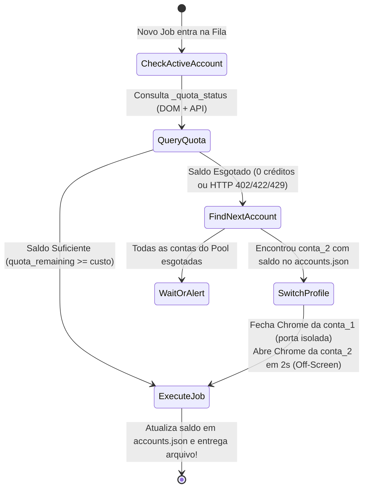

# 👥 Sistema Multi-Login & Rotação Inteligente de Créditos/Limites (`accounts.json`)

Muitas plataformas web oferecem planos gratuitos ou profissionais com **limites diários ou mensais por conta** (por exemplo: o *Adobe Podcast Free* permite 1 hora de áudio por dia por conta; geradores de vídeo/música dão 50 ou 100 créditos diários por login).

O **MCP Creator — Connect Anything** inclui um motor nativo de **Multi-Profile Pool & Smart Quota Failover** para multiplicar sua capacidade operacional sem fricção.

---

## 1. Como Funciona o Isolamento de Perfis por Conta

Em vez de fazer logout e login na mesma aba (o que aciona alertas de segurança e exige 2FA toda vez), cada conta cadastrada no MCP ganha seu próprio **Diretório de Perfil do Google Chrome 100% Isolado**:

- `conta_1` (Principal) $\rightarrow$ `C:\<prefix>-mcp-profile`
- `conta_2` (Secundária) $\rightarrow$ `C:\<prefix>-mcp-profile-conta_2`
- `conta_3` (Terciária) $\rightarrow$ `C:\<prefix>-mcp-profile-conta_3`

Cada diretório guarda seus próprios cookies de sessão, `localStorage`, `IndexedDB` e marcador `.login_completed`. Você faz login **uma única vez** em cada conta e todas permanecem logadas simultaneamente!

---

## 2. Máquina de Estados do Smart Quota Failover



---

## 3. Gerenciando Contas pelo Agente de IA (ou via Dashboard)

Qualquer Agente de IA conectado ao seu MCP pode gerenciar o pool de contas usando a tool `<prefix>_accounts`:

### Listar todas as contas e saldos consolidados do Pool
```json
{
  "action": "list"
}
```
Retorna quantas contas existem no pool, qual está ativa, quanto de crédito/tempo resta em cada uma e a **soma total disponível no pool** (`pool_remaining`).

### Adicionar uma nova conta ao Pool (abre visível para o 1º login)
```json
{
  "action": "add",
  "account_id": "conta_2",
  "label": "Conta Secundária (Gmail 2)",
  "open_login": true
}
```

### Alternar manualmente para outra conta
```json
{
  "action": "switch",
  "account_id": "conta_2"
}
```

### Ativar ou desativar o Failover Automático (`auto_rotate`)
```json
{
  "action": "set_auto_rotate",
  "auto_rotate": true
}
```

---

## 4. Como Personalizar o Leitor de Créditos (`consultar_quota_plataforma`)

No arquivo `selectors.json` do MCP gerado, você pode configurar dois mecanismos complementares para ler os créditos/limites do site:

1. **Via Seletor DOM/Shadow-DOM (`selectors.quota_badge`)**:
   Aponte `quota_badge` para o elemento visual que mostra os créditos no topo/menu do site (ex: `[data-testid="credits-remaining"], .credits-pill`). O motor extrai automaticamente o valor numérico em tempo real!
2. **Via Endpoint de API Interna (`api_endpoints.user_quota_path`)**:
   Se o site possui um endpoint JSON como `/api/v1/user_metrics` ou `/api/v1/credits` (facilmente descoberto rodando `<prefix>_diagnose` e olhando `recent_network_calls`), basta ler o campo JSON dentro de `consultar_quota_plataforma()` em `<prefix>api.py` — exatamente como fazemos no **Adobe Podcast MCP** (`phonos-server-flex.adobe.io/api/v1/user_metrics`).
